# math-render

A Rust library that lays out mathematical formulas (MathML in, positioned glyphs out) using the
**OpenType `MATH` table** of a font and [HarfBuzz](https://harfbuzz.github.io/) for shaping.
It implements the typesetting rules from the OpenType MATH specification and
[MathML Core](https://www.w3.org/TR/mathml-core/): script and fraction placement, stretchy operators,
radicals, tables, accents, italic corrections, math kerning and more, all driven by the metrics the font
provides, so a well-made math font gives you good output without any hand-tuned constants.

## Gallery

Every formula below is laid out by this crate and rendered to SVG with the bundled `mathimg` tool,
once per font. The only thing that changes between the renderings is the font.

### Fractions, radicals & continued fractions

Nested fractions shrink through script styles, and the radical's surd and rule are built from the font's `MATH` table variants and assemblies.

<table>
<tr><td width="150"><sub>Latin Modern Math</sub></td><td><picture><source media="(prefers-color-scheme: dark)" srcset="docs/img/quadratic-latinmodern-dark.svg">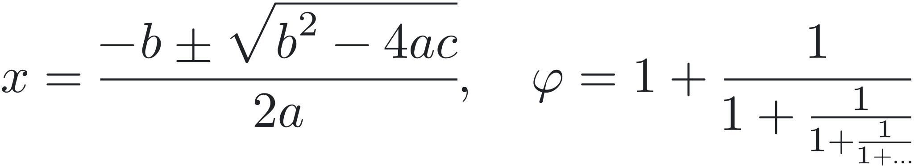</picture></td></tr>
<tr><td width="150"><sub>TeX Gyre Pagella Math</sub></td><td><picture><source media="(prefers-color-scheme: dark)" srcset="docs/img/quadratic-pagella-dark.svg">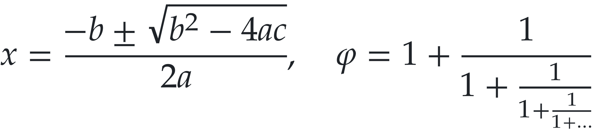</picture></td></tr>
<tr><td width="150"><sub>TeX Gyre Termes Math</sub></td><td><picture><source media="(prefers-color-scheme: dark)" srcset="docs/img/quadratic-termes-dark.svg">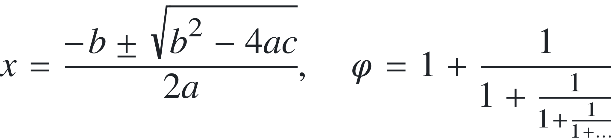</picture></td></tr>
<tr><td width="150"><sub>Asana Math</sub></td><td><picture><source media="(prefers-color-scheme: dark)" srcset="docs/img/quadratic-asana-dark.svg">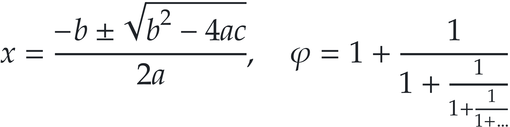</picture></td></tr>
<tr><td width="150"><sub>TeX Gyre Bonum Math</sub></td><td><picture><source media="(prefers-color-scheme: dark)" srcset="docs/img/quadratic-bonum-dark.svg">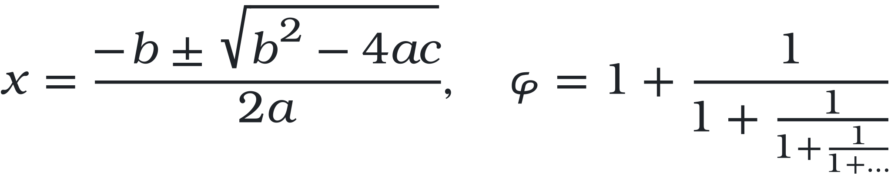</picture></td></tr>
<tr><td width="150"><sub>TeX Gyre DejaVu Math</sub></td><td><picture><source media="(prefers-color-scheme: dark)" srcset="docs/img/quadratic-dejavu-dark.svg">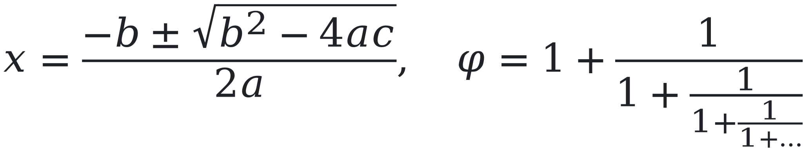</picture></td></tr>
</table>

For comparison, the same formula as LaTeX, rendered live by GitHub (MathJax) in your browser:

$$
x = \frac{-b \pm \sqrt{b^2-4ac}}{2a}, \qquad \varphi = 1 + \cfrac{1}{1 + \cfrac{1}{1 + \cfrac{1}{1 + \dots}}}
$$

<details>
<summary>MathML source</summary>

```xml
<math display="block">
  <mi>x</mi><mo>=</mo>
  <mfrac>
    <mrow><mo>&minus;</mo><mi>b</mi><mo>&pm;</mo>
      <msqrt><msup><mi>b</mi><mn>2</mn></msup><mo>&minus;</mo><mn>4</mn><mi>a</mi><mi>c</mi></msqrt>
    </mrow>
    <mrow><mn>2</mn><mi>a</mi></mrow>
  </mfrac>
  <mo>,</mo><mspace width="1em"/>
  <mi>&phi;</mi><mo>=</mo>
  <mn>1</mn><mo>+</mo>
  <mfrac><mn>1</mn><mrow><mn>1</mn><mo>+</mo><mfrac><mn>1</mn><mrow><mn>1</mn><mo>+</mo><mfrac><mn>1</mn><mrow><mn>1</mn><mo>+</mo><mo>&hellip;</mo></mrow></mfrac></mrow></mfrac></mrow></mfrac>
</math>
```

</details>

### Big operators with limits, integrals

Display-style `∑` is enlarged and gets under/over limits, while `∫` takes its limits as scripts and is italic-corrected.

<table>
<tr><td width="150"><sub>Latin Modern Math</sub></td><td><picture><source media="(prefers-color-scheme: dark)" srcset="docs/img/basel-latinmodern-dark.svg">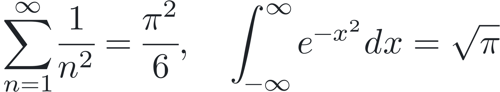</picture></td></tr>
<tr><td width="150"><sub>TeX Gyre Pagella Math</sub></td><td><picture><source media="(prefers-color-scheme: dark)" srcset="docs/img/basel-pagella-dark.svg">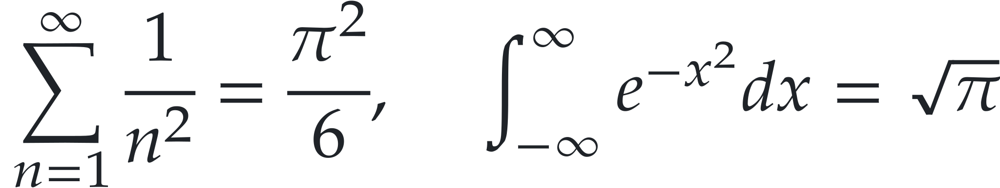</picture></td></tr>
<tr><td width="150"><sub>TeX Gyre Termes Math</sub></td><td><picture><source media="(prefers-color-scheme: dark)" srcset="docs/img/basel-termes-dark.svg">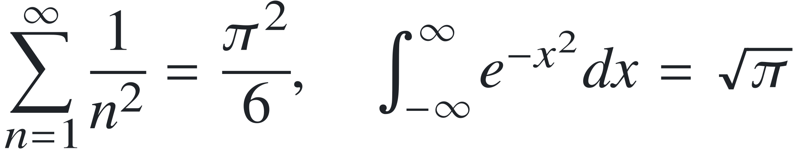</picture></td></tr>
<tr><td width="150"><sub>Asana Math</sub></td><td><picture><source media="(prefers-color-scheme: dark)" srcset="docs/img/basel-asana-dark.svg">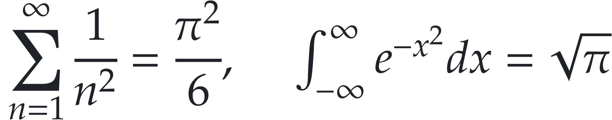</picture></td></tr>
<tr><td width="150"><sub>TeX Gyre Bonum Math</sub></td><td><picture><source media="(prefers-color-scheme: dark)" srcset="docs/img/basel-bonum-dark.svg">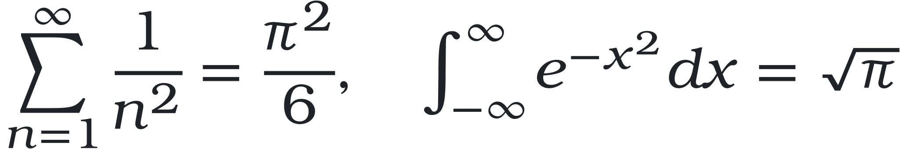</picture></td></tr>
<tr><td width="150"><sub>TeX Gyre DejaVu Math</sub></td><td><picture><source media="(prefers-color-scheme: dark)" srcset="docs/img/basel-dejavu-dark.svg">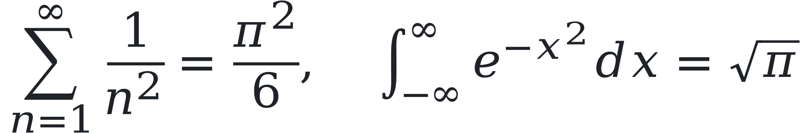</picture></td></tr>
</table>

For comparison, the same formula as LaTeX, rendered live by GitHub (MathJax) in your browser:

$$
\sum_{n=1}^{\infty} \frac{1}{n^2} = \frac{\pi^2}{6}, \qquad \int_{-\infty}^{\infty} e^{-x^2}\,dx = \sqrt{\pi}
$$

<details>
<summary>MathML source</summary>

```xml
<math display="block">
  <munderover><mo>&Sum;</mo><mrow><mi>n</mi><mo>=</mo><mn>1</mn></mrow><mi>&infin;</mi></munderover>
  <mfrac><mn>1</mn><msup><mi>n</mi><mn>2</mn></msup></mfrac>
  <mo>=</mo>
  <mfrac><msup><mi>&pi;</mi><mn>2</mn></msup><mn>6</mn></mfrac>
  <mo>,</mo><mspace width="1em"/>
  <msubsup><mo>&int;</mo><mrow><mo>&minus;</mo><mi>&infin;</mi></mrow><mi>&infin;</mi></msubsup>
  <msup><mi>e</mi><mrow><mo>&minus;</mo><msup><mi>x</mi><mn>2</mn></msup></mrow></msup>
  <mi>d</mi><mi>x</mi>
  <mo>=</mo>
  <msqrt><mi>&pi;</mi></msqrt>
</math>
```

</details>

### Stretchy operators & bold vectors

Contour and surface integrals with the correct glyph variants, plus bold math alphanumerics.

<table>
<tr><td width="150"><sub>Latin Modern Math</sub></td><td><picture><source media="(prefers-color-scheme: dark)" srcset="docs/img/stokes-latinmodern-dark.svg">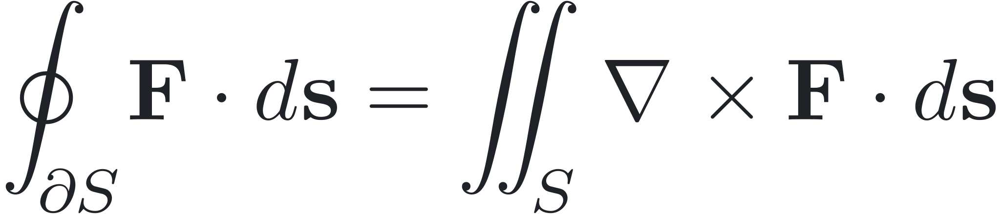</picture></td></tr>
<tr><td width="150"><sub>TeX Gyre Pagella Math</sub></td><td><picture><source media="(prefers-color-scheme: dark)" srcset="docs/img/stokes-pagella-dark.svg">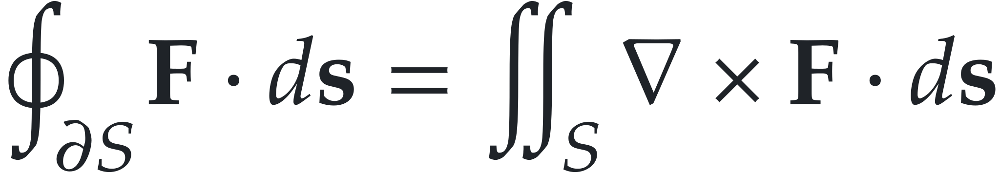</picture></td></tr>
<tr><td width="150"><sub>TeX Gyre Termes Math</sub></td><td><picture><source media="(prefers-color-scheme: dark)" srcset="docs/img/stokes-termes-dark.svg">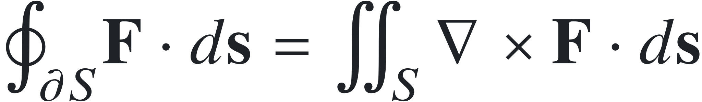</picture></td></tr>
<tr><td width="150"><sub>Asana Math</sub></td><td><picture><source media="(prefers-color-scheme: dark)" srcset="docs/img/stokes-asana-dark.svg">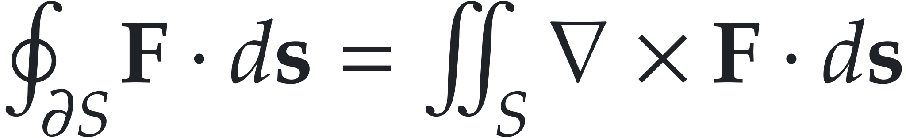</picture></td></tr>
<tr><td width="150"><sub>TeX Gyre Bonum Math</sub></td><td><picture><source media="(prefers-color-scheme: dark)" srcset="docs/img/stokes-bonum-dark.svg">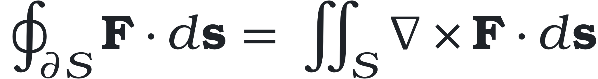</picture></td></tr>
</table>

For comparison, the same formula as LaTeX, rendered live by GitHub (MathJax) in your browser:

$$
\oint_{\partial S} \mathbf{F}\cdot d\mathbf{s} = \iint_S \nabla\times\mathbf{F}\cdot d\mathbf{s}
$$

<details>
<summary>MathML source</summary>

```xml
<math display="block">
  <msub><mo>&conint;</mo><mrow><mi>&part;</mi><mi>S</mi></mrow></msub>
  <mi mathvariant="bold">F</mi><mo>&sdot;</mo><mrow><mi>d</mi><mi mathvariant="bold">s</mi></mrow>
  <mo>=</mo>
  <msub><mo>&Int;</mo><mi>S</mi></msub>
  <mo>&Del;</mo><mo>&times;</mo><mi mathvariant="bold">F</mi><mo>&sdot;</mo><mrow><mi>d</mi><mi mathvariant="bold">s</mi></mrow>
</math>
```

</details>

### Tables, stretchy delimiters & cases

`mtable` layout with ellipsis glyphs; parentheses and braces stretch to the height of the content via glyph variants and assemblies.

<table>
<tr><td width="150"><sub>Latin Modern Math</sub></td><td><picture><source media="(prefers-color-scheme: dark)" srcset="docs/img/matrix-latinmodern-dark.svg">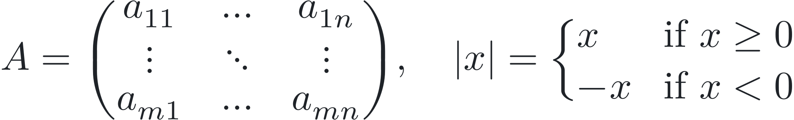</picture></td></tr>
<tr><td width="150"><sub>TeX Gyre Pagella Math</sub></td><td><picture><source media="(prefers-color-scheme: dark)" srcset="docs/img/matrix-pagella-dark.svg">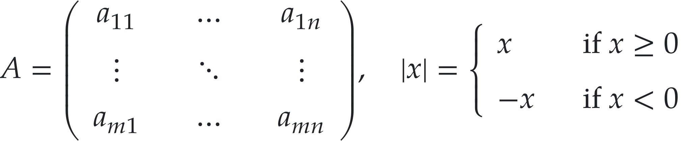</picture></td></tr>
<tr><td width="150"><sub>TeX Gyre Termes Math</sub></td><td><picture><source media="(prefers-color-scheme: dark)" srcset="docs/img/matrix-termes-dark.svg">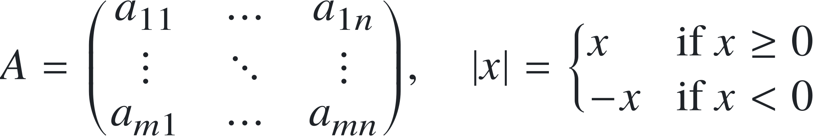</picture></td></tr>
<tr><td width="150"><sub>Asana Math</sub></td><td><picture><source media="(prefers-color-scheme: dark)" srcset="docs/img/matrix-asana-dark.svg">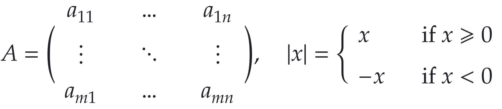</picture></td></tr>
<tr><td width="150"><sub>TeX Gyre Bonum Math</sub></td><td><picture><source media="(prefers-color-scheme: dark)" srcset="docs/img/matrix-bonum-dark.svg">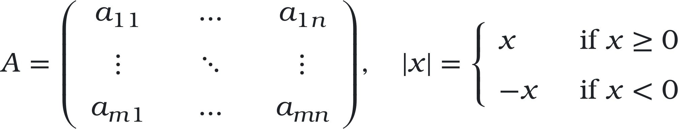</picture></td></tr>
<tr><td width="150"><sub>TeX Gyre DejaVu Math</sub></td><td><picture><source media="(prefers-color-scheme: dark)" srcset="docs/img/matrix-dejavu-dark.svg">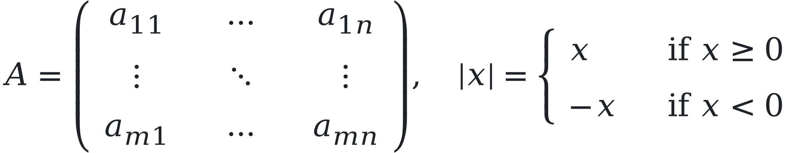</picture></td></tr>
</table>

For comparison, the same formula as LaTeX, rendered live by GitHub (MathJax) in your browser:

$$
A = \begin{pmatrix} a_{11} & \cdots & a_{1n} \\ \vdots & \ddots & \vdots \\ a_{m1} & \cdots & a_{mn} \end{pmatrix}, \qquad |x| = \begin{cases} x & \text{if } x \ge 0 \\ -x & \text{if } x < 0 \end{cases}
$$

<details>
<summary>MathML source</summary>

```xml
<math display="block">
  <mi>A</mi><mo>=</mo>
  <mrow><mo>(</mo>
    <mtable>
      <mtr><mtd><msub><mi>a</mi><mn>11</mn></msub></mtd><mtd><mo>&hellip;</mo></mtd><mtd><msub><mi>a</mi><mrow><mn>1</mn><mi>n</mi></mrow></msub></mtd></mtr>
      <mtr><mtd><mo>&vellip;</mo></mtd><mtd><mo>&dtdot;</mo></mtd><mtd><mo>&vellip;</mo></mtd></mtr>
      <mtr><mtd><msub><mi>a</mi><mrow><mi>m</mi><mn>1</mn></mrow></msub></mtd><mtd><mo>&hellip;</mo></mtd><mtd><msub><mi>a</mi><mrow><mi>m</mi><mi>n</mi></mrow></msub></mtd></mtr>
    </mtable>
  <mo>)</mo></mrow>
  <mo>,</mo><mspace width="1em"/>
  <mrow><mo>|</mo><mi>x</mi><mo>|</mo></mrow><mo>=</mo>
  <mrow><mo>{</mo>
    <mtable columnalign="left">
      <mtr><mtd><mi>x</mi></mtd><mtd><mtext>if&#xA0;</mtext><mi>x</mi><mo>&ge;</mo><mn>0</mn></mtd></mtr>
      <mtr><mtd><mo>&minus;</mo><mi>x</mi></mtd><mtd><mtext>if&#xA0;</mtext><mi>x</mi><mo>&lt;</mo><mn>0</mn></mtd></mtr>
    </mtable>
  </mrow>
</math>
```

</details>

### Fractions, brackets, accents

Quantum-mechanics notation: stretchy brackets and bras/kets, `ħ`, a wide-hat accent, and the Laplacian.

<table>
<tr><td width="150"><sub>Latin Modern Math</sub></td><td><picture><source media="(prefers-color-scheme: dark)" srcset="docs/img/schrodinger-latinmodern-dark.svg">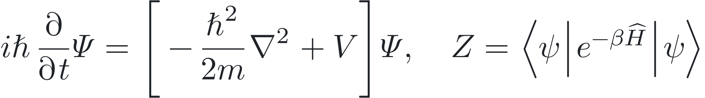</picture></td></tr>
<tr><td width="150"><sub>TeX Gyre Pagella Math</sub></td><td><picture><source media="(prefers-color-scheme: dark)" srcset="docs/img/schrodinger-pagella-dark.svg">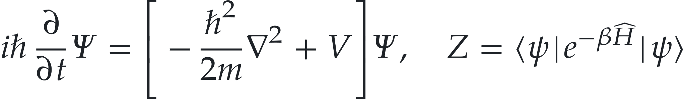</picture></td></tr>
<tr><td width="150"><sub>TeX Gyre Termes Math</sub></td><td><picture><source media="(prefers-color-scheme: dark)" srcset="docs/img/schrodinger-termes-dark.svg">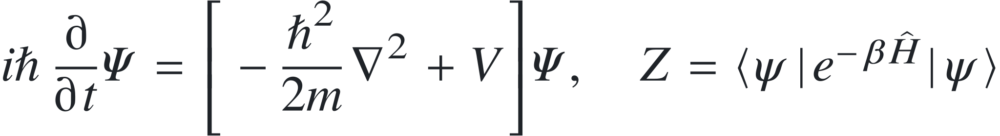</picture></td></tr>
<tr><td width="150"><sub>Asana Math</sub></td><td><picture><source media="(prefers-color-scheme: dark)" srcset="docs/img/schrodinger-asana-dark.svg">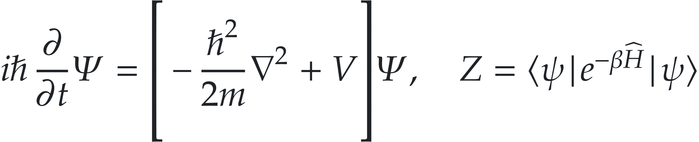</picture></td></tr>
<tr><td width="150"><sub>TeX Gyre Bonum Math</sub></td><td><picture><source media="(prefers-color-scheme: dark)" srcset="docs/img/schrodinger-bonum-dark.svg">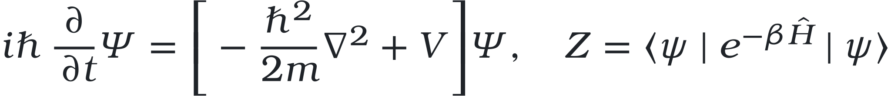</picture></td></tr>
<tr><td width="150"><sub>TeX Gyre DejaVu Math</sub></td><td><picture><source media="(prefers-color-scheme: dark)" srcset="docs/img/schrodinger-dejavu-dark.svg">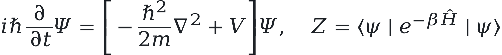</picture></td></tr>
</table>

For comparison, the same formula as LaTeX, rendered live by GitHub (MathJax) in your browser:

$$
i\hbar\frac{\partial}{\partial t}\Psi = \left[-\frac{\hbar^2}{2m}\nabla^2 + V\right]\Psi, \qquad Z = \langle\psi|\,e^{-\beta\hat H}\,|\psi\rangle
$$

<details>
<summary>MathML source</summary>

```xml
<math display="block">
  <mi>i</mi><mi>&hbar;</mi>
  <mfrac><mo>&part;</mo><mrow><mo>&part;</mo><mi>t</mi></mrow></mfrac>
  <mi>&Psi;</mi><mo>=</mo>
  <mrow><mo>[</mo>
    <mo>&minus;</mo>
    <mfrac><msup><mi>&hbar;</mi><mn>2</mn></msup><mrow><mn>2</mn><mi>m</mi></mrow></mfrac>
    <msup><mo>&nabla;</mo><mn>2</mn></msup><mo>+</mo><mi>V</mi>
  <mo>]</mo></mrow>
  <mi>&Psi;</mi>
  <mo>,</mo><mspace width="1em"/>
  <mi>Z</mi><mo>=</mo>
  <mrow><mo stretchy="false">&langle;</mo><mi>&psi;</mi><mo stretchy="false">|</mo><msup><mi>e</mi><mrow><mo>&minus;</mo><mi>&beta;</mi><mover accent="true"><mi>H</mi><mo>&#x302;</mo></mover></mrow></msup><mo stretchy="false">|</mo><mi>&psi;</mi><mo stretchy="false">&rangle;</mo></mrow>
</math>
```

</details>

### Prescripts (`mmultiscripts`)

Stacked pre-super/subscripts as used for isotopes and tensor indices.

<table>
<tr><td width="150"><sub>Latin Modern Math</sub></td><td><picture><source media="(prefers-color-scheme: dark)" srcset="docs/img/nuclear-latinmodern-dark.svg">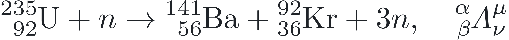</picture></td></tr>
<tr><td width="150"><sub>TeX Gyre Pagella Math</sub></td><td><picture><source media="(prefers-color-scheme: dark)" srcset="docs/img/nuclear-pagella-dark.svg">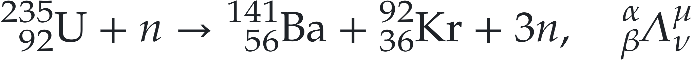</picture></td></tr>
<tr><td width="150"><sub>TeX Gyre Termes Math</sub></td><td><picture><source media="(prefers-color-scheme: dark)" srcset="docs/img/nuclear-termes-dark.svg">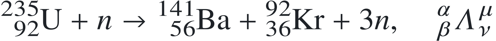</picture></td></tr>
<tr><td width="150"><sub>Asana Math</sub></td><td><picture><source media="(prefers-color-scheme: dark)" srcset="docs/img/nuclear-asana-dark.svg">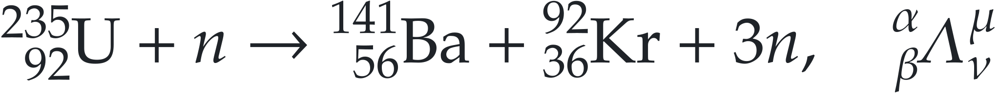</picture></td></tr>
<tr><td width="150"><sub>TeX Gyre Bonum Math</sub></td><td><picture><source media="(prefers-color-scheme: dark)" srcset="docs/img/nuclear-bonum-dark.svg">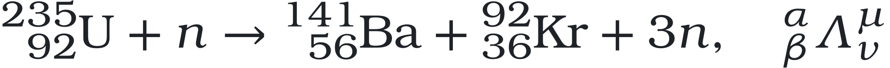</picture></td></tr>
<tr><td width="150"><sub>TeX Gyre DejaVu Math</sub></td><td><picture><source media="(prefers-color-scheme: dark)" srcset="docs/img/nuclear-dejavu-dark.svg">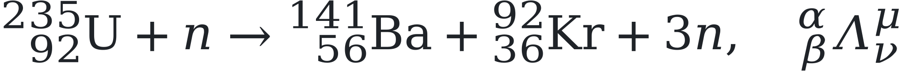</picture></td></tr>
</table>

For comparison, the same formula as LaTeX, rendered live by GitHub (MathJax) in your browser:

$$
{}^{235}_{\;\,92}\mathrm{U} + n \to {}^{141}_{\;\,56}\mathrm{Ba} + {}^{92}_{\;\,36}\mathrm{Kr} + 3n, \qquad {}^{\alpha}_{\beta}\Lambda^{\mu}_{\nu}
$$

<details>
<summary>MathML source</summary>

```xml
<math display="block"><mmultiscripts><mi mathvariant="normal">U</mi><mprescripts/><mn>92</mn><mn>235</mn></mmultiscripts><mo>+</mo><mi>n</mi><mo>&rarr;</mo><mmultiscripts><mi>Ba</mi><mprescripts/><mn>56</mn><mn>141</mn></mmultiscripts><mo>+</mo><mmultiscripts><mi>Kr</mi><mprescripts/><mn>36</mn><mn>92</mn></mmultiscripts><mo>+</mo><mn>3</mn><mi>n</mi><mo>,</mo><mspace width="1em"/><mmultiscripts><mi>&Lambda;</mi><mi>&nu;</mi><mi>&mu;</mi><mprescripts/><mi>&beta;</mi><mi>&alpha;</mi></mmultiscripts></math>
```

</details>

## License

See [LICENSE](LICENSE).
